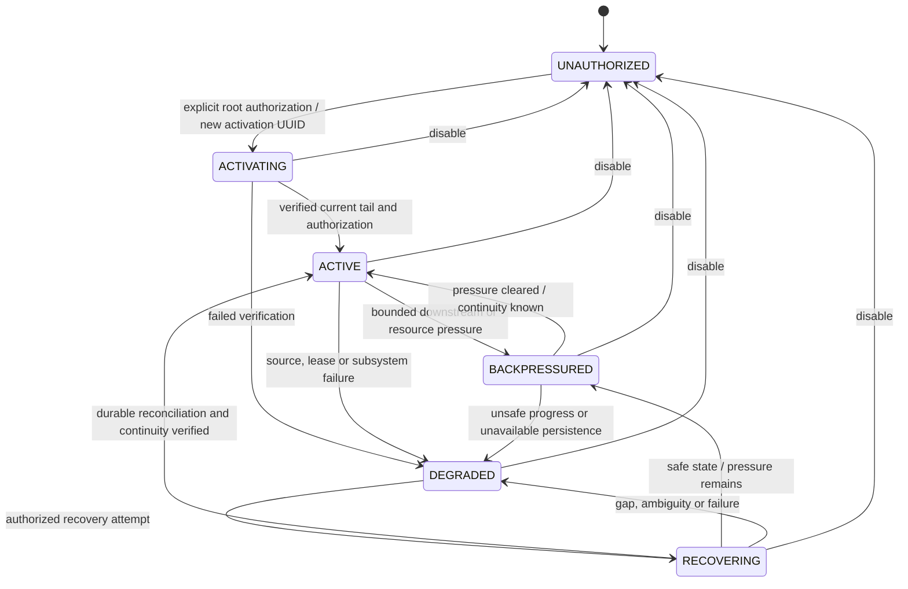
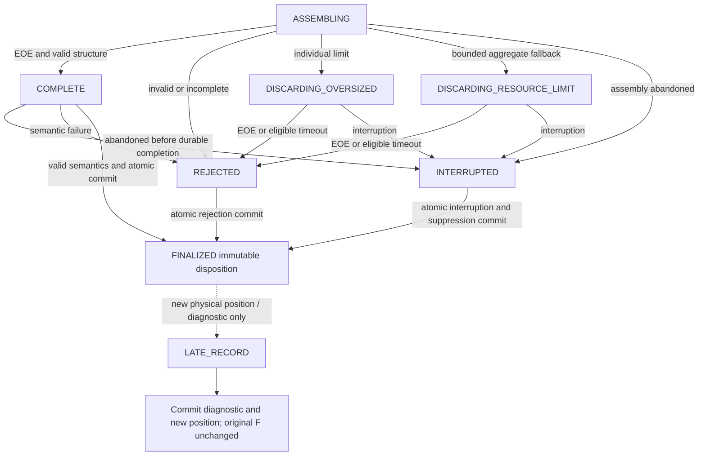
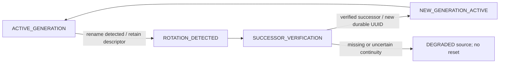
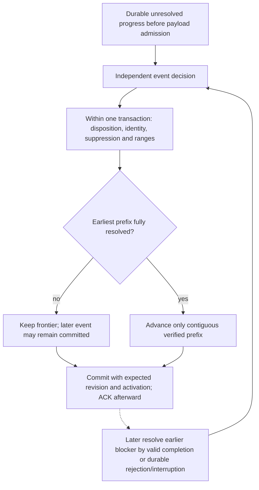

# M3 — Linux Audit execution monitoring decisions

**Status:** Owner-approved plugin source and EOE-only completion. Implementation and acceptance are in progress.

**Prepared:** November 8, 2026\
**Consolidated:** November 9, 2026 (master decisions and evidence/state-machine addendum; documentation only)

**Target:** One Ubuntu 26.04 LTS host with native AArch64 Audit execution records.

## Current source decision

The owner approved an outbound auditd plugin as the M3 input, retaining EOE as
the sole completion marker. The [native Ubuntu probe](../../tests/integration/M3-README.md#native-ubuntu-source-finding)
and [auditd 4.1.2 source](https://raw.githubusercontent.com/linux-audit/audit-userspace/v4.1.2/src/auditd.c#L331)
established that the local file does not carry EOE.

This decision supersedes RAW-file ingestion and its file-specific mechanics below,
including byte cursors, rename rotation, and replay from file checkpoints. Those
sections describe the previous design. Preserve explicit activation, bounded
volatile payloads, non-root processing, independent Python validation and writes,
interruption suppression, and no fabricated completion. Plugin transport framing,
privilege separation before input reads, loss reporting and durable event identity
need target evidence before live deployment. Auditd configuration and original logs
remain under host administration.

The current implementation adds explicit activation and interrupted-stream restart
handling, with separate root control and reader data endpoints. The installed
service, launcher, current-tail gate, revocation, restart, storage-failure and
native-source path have passed a controlled Ubuntu acceptance round. Upstream
health sampling now has a separate owner-approved privileged checker. Resource and sustained-load hardening remain open. Controlled quiet
probes found prompt EOE after clean auditd startup and a repeatable one-record
delay after plugins were removed/re-added through reload on Ubuntu's Audit
4.1.2 package. The latter is durably rejected per event, never accepted
without EOE. Root status distinguishes sampled counters from unavailable evidence; the
source-ready flag alone does not prove continuity. See the
[implementation and validation record](../../tests/integration/M3-README.md#activation-and-restart-integration).
The generation identifiers in that runtime identify plugin streams. They do not
assert continuity with the superseded file-generation design below.

The latest implementation durably rejects an individual expired assembly while
continuing independent events. Sanitized timeout policy/timing and subsequent
late positions survive restart; a late EOE cannot resurrect the event. Completed
native payload/history can retire from memory only after durable acknowledgment
and the safe volatile frontier; Python retains the authoritative disposition.
The 35 Python tests, 21 native sanitizer groups, installed runtime acceptance and
4,096-event load/controlled storage-pressure tests passed. See the
[latest evidence](../../tests/integration/M3-README.md#per-event-timeouts-and-sustained-workloads).

### Administrative rotation evidence under the plugin decision

Two real Ubuntu Audit file rotations passed while the same reader/plugin-stream
generation remained active, including a short SQLite writer stall. Known EOE-backed
executions reached durable storage and all original source inodes/byte prefixes
were retained; exact host policy was restored. See [scoped rotation acceptance](../validation/m3-rotation-validation.md).
This does not revive the historical file-generation machinery below or guarantee
indefinite retention against host-managed ROTATE/external cleanup. No production
logging-policy change, source deletion or archival mechanism is authorized by this test.

### Owner-approved health checker and source-health evidence

The owner explicitly approved the separate privileged health checker in this
conversation. Implementation and Ubuntu acceptance were updated November 11, 2026.
This approval preserves the capability-free event reader and Python backend, the
existing logging-policy constraint, EOE-only completion and root-only human access.
It does not authorize Git commits or publication.

The initial read-only probe returned `EPERM` for `AUDIT_GET` under `hids-audit`;
root could read host-wide kernel status. The
[Linux permission check](https://kernel.googlesource.com/pub/scm/linux/kernel/git/stable/linux-stable/+/refs/heads/linux-rolling-lts/kernel/audit.c)
uses `CAP_AUDIT_CONTROL` for this query, a permission that also allows Audit
configuration changes. The new short-lived C++ checker alone receives that
capability under systemd. Its code issues only fixed, unicast `AUDIT_GET`, binds no
multicast event groups, reads only derived dispatcher metadata and never changes
Audit configuration/rules or signals the daemon. It receives no security-event
payloads. Python independently validates reports and remains the only SQLite writer.

The checker uses a dedicated root-authenticated **health-only** endpoint,
`/run/hids/m3/health/metrics.sock`. The only operations are obtaining the current
authorized activation/generation and submitting a scoped observation. The endpoint
cannot activate/deactivate collection or issue a reader lease. The checker's mount
namespace hides the administrative socket, data socket, stored event data and other
`/run` services. It has an isolated network namespace, read-only host filesystem,
restricted address families, `NoNewPrivileges`, the Audit-only capability bounding
set, and a post-start syscall filter denying execution, signals and cross-process
memory/debug operations. Actual unit probes verified these restrictions. These
protections do **not** turn `CAP_AUDIT_CONTROL` into a kernel-enforced read-only
permission; exploitation of the remaining Audit access is a residual risk.

The timer is wanted by the M3 backend and both checker units are bound to its
lifetime. Explicit shutdown and backend SIGKILL stop the checker/timer. A missing
or untrusted health endpoint and health-table write failures remain visible without
stopping working event ingestion. The helper obtains authorized scope before
reading host counters; inactive intervals cause an exit without sampling.

One bounded row per activation retains the latest normalized observation, the first
readable kernel baseline, the preceding readable kernel observation for comparisons,
and sticky incident/availability flags. Control schema 3 migrates transactionally
to schema 4 by adding `m3_health`; existing intervals and event files are preserved.
The IPC family remains the internal version 3. Reports cannot cross activation or
generation boundaries, renew freshness by replay, or introduce unknown payload fields.
The current implementation uses a five-second reschedule, two-second helper deadline,
three-second service timeout and fifteen-second freshness window as provisional
operational settings, not release performance guarantees.

Kernel loss increments, counter decreases/resets, boot/PID changes, disabled Audit,
active-dispatcher overflow/suspension and monitor sampling gaps are separately labeled.
A loss count already present in the first sample is not attributed to HIDS or to
activity before/after activation. Latest receipt times do not date older sticky
incidents. These are host-wide observations, not exact per-HIDS lost-execution
counts, and sampled zero values never prove uninterrupted coverage.

On this VM `/run/audit/auditd.state` is root:adm mode 0640 and normally has no periodic
producer because `report_interval=0`. Missing, inaccessible, malformed, symlinked,
future-dated or stale metadata remains explicitly unavailable. With zero active
plugins, queueing suspension describes an inactive dispatcher rather than loss.
A lab-only operator test temporarily enabled one-second state reports and observed
three successive passive timer samples, then restored the original configuration.
The product never changes that setting or generates periodic signals to flush EOE.
Continuous dispatcher freshness therefore depends on independently administered
host reports. Kernel sampling works without that host setting.

The 46 Python tests, native metadata sanitizer suite, installed health acceptance,
actual isolation probe, periodic-report test and endpoint/crash lifecycle test passed.
The complete installed M3 suite also passed with the checker integrated. See
[health checker acceptance](../../tests/integration/M3-README.md#installed-health-checker-acceptance).

## 1. Scope, classifications and authority

M3 is intended to reconstruct existing Linux Audit execution events in C++20,
validate semantic contents, deliver a separate normalized M3 contract through
protected local IPC, and independently validate/persist it in Python. This is
single-native-event reconstruction, not v0.2 detection correlation. No detection
rules, user-facing security alerts, dashboard, remediation or hardening are added
by this milestone. Operational health, rejection and resource-exhaustion reporting
remain part of M3.

Use these four classifications throughout this specification and its register:

| Classification | Meaning |
|---|---|
| **Owner-approved** | The owner accepted the policy or architectural direction. |
| **Provisional** | The owner approved an initial policy/ceiling; numerical tuning or technical details still require validation. It is not merely an unapproved recommendation. |
| **Evidence-dependent** | Finalization requires actual Ubuntu inspection, representative controlled fixtures or measurements; do not guess. |
| **Future goal** | Deliberately excluded from initial M3 implementation. |

Policy approval is separate from permission to implement, create accounts, change
permissions/configuration, install packages, deploy, collect live data or test on
Ubuntu. Prior documentation-only entries describe their original scope. Preserve
historical research and M1/M2 validation evidence with their original limitations.

Keep C++ native collection/processing, Python independent normalized validation
and sole SQLite writes, Unix stream sockets/JSON Lines, least-privilege service
separation, local-first storage and root-only human security-data access. M1/M2
contracts, databases, source filters and behavior remain unchanged. Preserve
[ADR-006](../decisions/006-provisional-process-collection.md): Audit adds execution
context where existing policy supplies it, not a replacement for all cn_proc
FORK/EXEC/EXIT monitoring. Existing [ADRs](../decisions/) remain in force; this
source-specific design does not finalize ECS globally or change roadmap priorities.
The interruption policy in section 12 supersedes unfinished-event reconstruction
after restart; no known interrupted event may be restored into acceptance.

## 2. Recorded repository context and reusable components

The following inventory records the November 8 source inspection, distinct from
recommendations below; this documentation reconciliation does not revalidate source
behavior or rerun tests. The separate local structural increment is scoped in section 4.1:

| Existing component | Exact integration boundary |
|---|---|
| `collector/include/hids/journal_collector.hpp` | `Entry`, `JournalIo`, `JournalCollector::start/poll_once/committed/stop` are journal-specific; use their injectable-I/O pattern, not their record type. |
| `collector/src/journal_collector.cpp` | `normalize(const Entry&, ...)` produces journal-native provenance and fields; add a separate Audit normalization function. |
| `collector/src/journal/contract.cpp` | `parse`, `validate`, `canonical`, `identity`, `validate_response` implement the closed M2 contract; SSH pairs and cursor identity cannot represent Audit execution. |
| `collector/include/hids/journal/transport.hpp`, `collector/src/journal/transport.cpp` | `Channel`, `UnixChannel`, `exchange_line`, `request` provide bounded I/O/peer-check patterns. Existing event transport validation is M2-specific; do not call it with an M3 envelope. |
| `collector/src/journal/runtime.cpp` | `ReaderRuntime::start/step/exchange/stop`: authorization before source open, immutable pending bytes, bounded retries and reconciliation. Journal cursor semantics are not file checkpoints. |
| `engine/ingestion/m2_contract.py` | `decode`, `validate_event`, `canonical`, `validate_response`: closed protocol 2, `m2.journal-ssh/0.1.0`, 65536-byte payload/2048-byte responses. Add independent M3 validators. |
| `engine/ingestion/m2_receiver.py` | `PeerPolicy.check`, `Listener`, `Framer`, `service_policy`: Linux peer credentials, verified socket owner/mode, bounded framing; current reader identity is specifically UID 997. An Audit reader must not impersonate it. |
| `engine/ingestion/m2_service.py` | `RootPolicy.check`, `systemd_control_listener`, `Service.control/dispatch/drop`, `load_config`: one configured source, reader lease and global failure state. It is not an implemented multi-source router. |
| `engine/database/m2_store.py` | `Store.transaction/put/boundary/progress`, `get_event`: atomic disposition/progress, duplicate/conflict checks and read-only retrieval. Schema and cursor assumptions are M2-only. |
| `packaging/systemd/hids-{journal,ingest}.service`, `hids-ingest.socket` | Separate non-root reader/ingest identities, service-only journal/IPC groups, root-created control FD 3. Do not give ingestion Audit-log read permissions. |
| Native process collector/parser | `collector/src/{process_collector,process_connector_protocol,linux_process_connector}.cpp` remain separate; Audit is neither cn_proc input nor a `process::NativeEvent`. |

The [Ubuntu runtime report](../validation/m2-runtime-acceptance/ubuntu-runtime-acceptance.md)
is owner-reported: Stages 1–12, native archival tests and cleanup succeeded. Its
Stage 6 establishes client refusal and socket DAC denial, **not** a demonstrated
live backend negative peer-credential test. The historical
[readiness record](../validation/m2-runtime-acceptance/readiness-report.md),
[runbook](../validation/m2-runtime-acceptance/runbook.md), and
[lifecycle record](../validation/m2-lifecycle-validation.md) remain unchanged.

Older architecture/AGENTS/status passages still predate implemented M2. They are
not evidence that its source code is absent. This consolidation updates current
decisions only; it does not rewrite historical experiments or validation evidence.
Existing [Audit authentication research](../research/authentication.md) establishes
some authentication records, not EXECVE coverage on the present VM.

## 3. Collection policy, activation and source coverage

**Owner-approved:** use existing local Linux Audit log files, RAW format only,
initially for native AArch64 `execve` and `execveat`. Include successful and failed
attempts only when the complete supported record requirements are satisfied.
Enriched, remote/mixed-node and compressed streams are not initial supported inputs.
Actual format, configuration and execution coverage are **Evidence-dependent**.
A running auditd, authentication records or a readable empty log do not establish
execution coverage. Report absence/unobserved coverage and distinguish not-configured
only where proven. Never install rules to make coverage or acceptance pass.

The earlier integration alternatives are retained as rationale: an Audit plugin
requires logging-infrastructure configuration and can introduce dispatcher
backpressure; direct daemon registration conflicts with auditd ownership; read-only
netlink multicast is a different live/capability-bearing source without log replay.
None is the initial source. Never add plugins, register as the Audit daemon, change
Audit/auditd configuration or rules, grant Audit/DAC-bypass capabilities, modify
source permissions, or elevate automatically. Existing log access avoids reader
backpressure on auditd, but does not guarantee lossless upstream logging or retention.
See [auditd configuration](https://raw.githubusercontent.com/linux-audit/audit-userspace/v4.1.2/docs/auditd.conf.5)
and [Audit plugin documentation](https://raw.githubusercontent.com/linux-audit/audit-userspace/v4.1.2/docs/auditd-plugins.5).

### 3.1 Authorization and collection intervals

**Owner-approved:** explicit root authorization precedes all Audit payload reads.
Before activation inspect only approved metadata and permission evidence. Securely
open the approved source after activation, verify its identity and current file-end
boundary, and preserve that boundary before event emission. Recheck tail-start
rename/truncation races; exact framing/transaction steps are **Evidence-dependent**.
No historical backfill. Exclude and report events overlapping the activation
boundary rather than back-reading or calling partial records complete.

Disabling stops reading, releases source access and preserves committed evidence
and the last safe checkpoint. Re-enabling creates a new authorized interval at a
new verified current boundary. No automatic reactivation or disabled-period backfill.
Crash resume of source scanning and durable-delivery reconciliation is limited to
the same still-authorized interval with verifiable source identity and continuity.
It never authorizes reconstructing known interrupted event payload into acceptance.
Reboot or daemon reset does not authorize a new interval,
a guessed boot ID or merging uncertain identities. Exact persisted authorization,
reset/reboot reconciliation and revocation races remain **Evidence-dependent**.

## 4. Reconstruction, completeness and semantic parsing

### 4.1 Structural authority and native grouping

**Owner-approved:** native grouping identity is `(Audit timestamp, serial, node)`
within the configured local source and a verified stream/continuity scope. Preserve
original seconds, complete fractional digits, serial and node independently. Node
is opaque: do not resolve it through hostname/NSS databases or normalize it. A
consistently absent node is allowed. Reject conflicting node identities and
remote/mixed-node streams initially. Establishing local origin and consistent node
binding is **Evidence-dependent**; a hostname-looking label alone proves neither.
Never group by PID, command name, filename, adjacency or serial alone.

Physical identity is separate: configured source UUID, ingestion-assigned
file-generation UUID and first-record byte offset (section 6). Native timestamp
identity, original bytes/positions, record order, closure and volatile acknowledgment
remain structural responsibilities; libauparse must not infer or rewrite them.

The local working tree contains a separate fixture-driven structural increment,
described in `tests/integration/M3-README.md`. That untracked work is not modified
or published by this documentation task. Its Event metadata, local-node support,
limits and failure behavior must be reviewed for compatibility before integration.
A currently stricter or fail-sticky fixture component is not proof that the planned
production policy is implemented. Interface changes require separate authorization.

### 4.2 Completion and supported records

**Owner-approved:** EOE is the only initial structural completion marker. Validate
it structurally and exclude it from libauparse input. PROCTITLE never closes an
event initially. Timeout, shutdown, capacity exhaustion and discontinuity do not
establish completeness.
Reject malformed structure. Late records never silently establish completeness.
Finalized events remain immutable. EOE closure is not proof of valid fields or lossless delivery.

| Record | Owner-approved initial handling | Retained information |
|---|---|---|
| `SYSCALL` | Validate supported architecture/syscall, outcome and required execution/identity fields; do not classify from EXECVE presence alone. | Approved execution and identity context in section 5. Exact record cardinality/field grammar requires fixtures. |
| `EXECVE` | Require complete information across all supplied records. Validate argc, expected indices, fragments, ordering, missing/duplicate/conflicting fragments. Reject incomplete or absent corresponding EXECVE, including failed SYSCALL execution attempts. | Neither argc nor argument values. No fabricated argv and no PROCTITLE substitution. |
| `PATH` | Optional, repeated; validate every occurrence without deduplicating it. Never assume the first PATH is the executable. | Presence and record count; discard contents. |
| `CWD` | Optional singleton (maximum one); validate when present. | Presence only; discard contents. |
| `PROCTITLE` | Optional singleton (maximum one); validate when present. Never a completion marker or replacement for EXECVE. | Presence only; discard contents. |
| `EOE` | Structurally validated terminator, not parser payload. | Structural closure evidence. |

The previous open question about a failed SYSCALL without EXECVE is now resolved:
reject it as incomplete under the initial contract; do not create a separate
failed-execution event type. This does not exclude failed attempts whose supported
record information is complete. Distinguish absent records from incomplete supplied
sequences in bounded diagnostics without granting either partial normalized success.

**Future goal:** incomplete EXECVE support, a separate failed-execution representation
and PROCTITLE-based completion. Neither timeout nor libauparse's own completion rules
may serve as a workaround. Additional completion mechanisms need separate review.

### 4.3 Strict field and fragment validation

**Owner-approved:** reject unknown fields initially, use explicit record-specific
validation and reject duplicate singleton fields even when equal. No first/last-
value-wins. Preserve legitimate repeated EXECVE/PATH occurrences and validate every
field, including known fields discarded from output. Native GID fields can be known,
validated-discard fields; excluding GIDs from output does not make them unknown.

**Evidence-dependent:** exact RAW Audit lexical rules, supported record/field
allowlists, numeric ranges and fragment grammar. Verify argc/index/length/fragment
relationships across repeated EXECVE records; do not invent argument continuity,
escape, quoting, hex or byte-pair rules. Validate complete tokens, field names,
encoding, duplication/conflicts, bounds and overflow rather than relying on library
acceptance. Apply field-specific rules to discarded values too; encoded separators
in discarded data never permit raw NUL input or embedded NUL in retained exe/comm. Unknown/unsupported encodings or records cannot be silently
accepted to improve coverage. Malformed input invalidates the entire semantic result.

**Future goal:** validated check-and-discard support for unknown fields. Current
strict rejection remains in force until that extension is approved and validated.

### 4.4 Fresh BUFFER lifecycle and temporary timestamps

**Owner-approved:** use a fresh `AUSOURCE_BUFFER` per structurally reconstructed
event, with EOE excluded, complete bounded NUL-terminated input, full traversal and
positional accounting. No FEED/callback parsing, persistent parser state or fallback
to another architecture. Recommend libauparse over independently implementing a
complete Audit grammar, subject to dependency approval (section 9.1).

The accepted parser-compatibility policy is temporary three-digit truncation when
needed. Do not reselect rounding:

| Original fraction | Temporary fraction |
|---|---|
| `.1` | `.100` |
| `.123` | `.123` |
| `.123456` | `.123` |
| `.123456789` | `.123` |

Original seconds, full fraction, serial, node, record bytes, byte offsets and
structural identity remain unchanged. Temporary millisecond values must never
be used for durable identity, deduplication, ordering or checkpointing. Collisions
between temporary times cannot merge structural events. Supported fractional widths
and exact source ranges remain **Evidence-dependent**; the four examples do not
approve every possible width or change structural acceptance rules.

Required lifecycle for the eventual adapter:

1. Verify structural eligibility and approved bounds before normalized construction.
   Enumerate original records (including EOE for original size accounting), reject
   embedded NUL and malformed timestamps, and identify exact replacement spans.
2. Compute projected non-EOE input length without constructing it. Check every size
   addition/subtraction for overflow, enforce bounds and overflow-check `length + 1`.
   Populate a bounded final buffer in structural order with required delimiters
   and a terminating NUL. Bound intermediate/decoded copies separately.
3. Initialize `auparse_init(AUSOURCE_BUFFER, buffer)`. This API requires NUL
   termination and copies its input; it is not an explicit-length initializer.
   NULL is a parser-initialization failure, not proof of application bad_alloc.
4. Drain every event with `auparse_next_event()` (positive: event, zero: exhaustion,
   negative: error), and inspect every returned record and field. Use raw numeric
   values, not interpreted account names or host-dependent NSS/path transformations.
5. Independently validate semantics and compare returned records positionally with
   expected types and complete temporary record representations. Every supplied
   non-EOE occurrence must match exactly once in order. Missing, silently skipped,
   extra, duplicated, reordered or unexpectedly rewritten records invalidate output.
6. Return one complete semantic result or one typed failure, never partially populated
   success. Use RAII on every path and discard temporary sensitive values. No raw
   values in diagnostics; no claim of secure erasure of all library allocations.

**Evidence-dependent:** actual installed-library API/header/ABI behavior, internal
allocation-free result/failure API, malformed-record behavior and allocation/traversal
failure vectors. No API implementation is authorized by this lifecycle description.
Successful library parsing is not semantic validity or structural completeness.

## 5. Initial normalized execution and privacy requirements

**Owner-approved:** M3 will use its own `m3.audit-exec/0.1.0` contract, protocol 3 and separate
ingestion boundary. The contract/protocol direction is approved; exact closed JSON
objects, response/control messages, encoding tags and validation vectors remain
**Evidence-dependent**. Do not send M3 through M2's SSH contract or finalize global
ECS mappings from this source-specific requirement set.

| Retained information | Owner-approved requirement | Evidence still needed |
|---|---|---|
| Identity | Mandatory `uid`, `euid`, `suid`, `fsuid`, `auid`, `session_id` (native `ses`). Reject missing/malformed values. No normalized GID fields. | Field-specific ranges, numeric wire representation and explicit-unset encodings. |
| Execution | Architecture, syscall number/name, success/failure, syscall return value, PID, PPID, full exe and comm. | Exact field names/types, RAW encodings and fixtures. No invented TGID or process-exit status; syscall return is not eventual process exit. |
| Record context | PATH presence/count; CWD and PROCTITLE presence. | Exact contract keys and consistency checks. Values remain discarded. |
| Source time/identity | Original Audit seconds as decimal string, exact fraction string, separate serial decimal string, opaque node and physical source provenance. | Exact ranges, node binding and envelope representation. |
| Observation/storage | C++ observation timestamp separate from native activity time; Python receipt and persistence timestamps separately attributed. | Exact representations and clock/failure rules; no invented or substituted activity time. |

Preserve every valid identity number exactly. Preserve recognized explicit-unset
sentinels distinctly from missing or malformed fields; never turn unset AUID into
root/euid or infer any identity from another. Field-specific sentinel forms and
numeric ranges must be verified rather than assuming every UINT32_MAX has the same
meaning. A mandatory field may carry explicit unset where defined; it cannot become
an absent optional field. Missing and malformed remain distinct rejection reasons.

Operation is determined from `(audit_arch, syscall_number)`, not comm, exe, PROCTITLE
or EXECVE presence. Native AArch64 is the **Owner-approved** initial scope; candidate
UAPI values `0xC00000B7`, execve 221 and execveat 281 require target-header/fixture
verification before support is claimed. Unsupported/compat architectures fail closed.

Executed target evidence (November 11, 2026): the Ubuntu AArch64 contract build
asserts those architecture/syscall constants against its installed UAPI headers.
The linked corpus now covers 124 current-profile boundary cases, and controlled
allocation/API faults verify empty typed output and safe source interruption.
See [native/parser acceptance](../../tests/integration/M3-README.md#native-contract-boundaries-and-parser-failure-acceptance).
This does not close broader native field/marker/range or redistribution gates.

Preserve original time precision, clock reversals and serial resets. No float
conversion, invented boot or monotonic identity, local-time substitution, synthetic
activity timestamp or silent precision change. Keep observation, receipt and
persistence clocks distinct. Missing native identity/time cannot be repaired with
observation time. Receipt/storage failures must not be described as confirmed activity.

### 5.1 Executable bytes and encoding

**Owner-approved:** retain the original decoded bytes of `exe` and `comm`, distinct
from arguments. Base64 is required in IPC and persistent storage; it is encoding,
not encryption. Decode for display only when bytes are valid UTF-8. Do not silently
replace/normalize invalid bytes, infer names, or truncate. Reject embedded NUL in
these retained fields. Apply decoded-byte limits before Base64 encoding and account
for checked Base64 expansion within the request-size limit.

| Field | Provisional decoded-byte ceiling |
|---|---:|
| exe | 4,096 bytes |
| comm | 256 bytes |

These are **Provisional** owner-approved initial limits, not unresolved suggestions;
validate them and their encoding/framing behavior. Exact Base64 keys/tags and
canonical comparison rules require the contract addendum. Retaining full bytes
within bounds does not authorize oversized-value truncation.

Do not persist argc, arguments, environment, PATH contents, CWD contents, PROCTITLE
contents or raw Audit records in HIDS normalized data, progress ledgers or diagnostics.
Preservation of existing original source generations is distinct; see
[Section 6.4](#64-original-source-evidence-and-retirement-eligibility).
Validate them transiently within approved bounds;
never place them in diagnostics, spools, exports or crash-report payloads. Read
permission exposes broader logs to the reader than the output whitelist; filtering
is data minimization, not an OS access boundary.

**Future goal:** encryption at rest for sensitive exe/comm identity, including key
management. No encryption is implemented or implied by Base64 or root-only access.

## 6. Physical identity, rotation, checkpoints and crash recovery

### 6.1 Generations and rename-only rotation

**Owner-approved:** physical identity comprises configured source UUID, persistent
ingestion-assigned file-generation UUID and first-record byte offset. A candidate
serialization remains `a1.<source>.<first-generation>.<first-offset>`; the exact ID
encoding is **Evidence-dependent**, not PID, serial or content hash alone. Preserve
native grouping identity independently. No cross-source correlation/import identity
or historical backfill is implied.

Verify device/inode, creation observations, bounded integrity anchors and successor
relationships; device/inode can be reused and filenames alone are not trusted.
Retain generation identity across rename rotation, keep old descriptors while
processing old generations and preserve the first-record identity when an event
crosses a verified rotation. New process instances/pathnames do not create new
source generations automatically.

Support rename rotation only initially. Report/reject copytruncate, missing source
generations, unexpected replacement, uncertain inode reuse, unverified succession,
compression and unexpected permission changes. Never silently restart at beginning
or tail. Exact identity anchors and race/recovery proof are **Evidence-dependent**.
**Future goal:** compressed archive support.

### 6.2 Contiguous frontier and atomic Python persistence

**Owner-approved:** use a contiguous resolved-byte frontier. An earlier unresolved
event prevents advancing beyond its first unresolved position even if later
interleaved events finish. Resolve only proven record intervals; never treat an
entire interleaved event span as ownership of all enclosed bytes. Existing volatile structural acknowledgment
is not the durable range/frontier algorithm or a lossless-delivery guarantee; its
compatibility must be reviewed without changing the current component here.

Python alone owns durable writes. One transaction must atomically persist the
execution event or rejection disposition, canonical identity, relevant source ranges,
finalization/interruption disposition, resolved-range/source-progress updates,
checkpoint advancement and expected revision/activation checks. Reject stale
revision or activation updates. No arbitrary collector checkpoint writes.
Handle unrelated Audit records through bounded scan-progress accounting proving
that no unresolved group was skipped; retain no unrelated payloads.

### 6.3 Interrupted payload is discarded; durable dispositions are immutable

**Owner-approved:** this policy supersedes earlier source reconstruction of unfinished
events after interruption. A crash, restart, shutdown or other abandonment of accepted
assembly produces an INTERRUPTED sanitized disposition and health/rejection report.
Discard unfinished payload permanently as an execution candidate. Never rebuild that
event into an accepted execution, infer its missing records, or silently treat it as
success. Raw records, argv/environment and partial executable payloads are not durable.

Before accepting record payload into assembly, sanitized source/event progress must
be durably registered by Python. If that registration is unavailable or uncertain,
pause/reconcile before admission. On recovery, registered unfinished progress is
interrupted and suppressed; source bytes not yet durably registered are not falsely
claimed as prior assembly. Later complete, independently committed interleaved events
remain preserved. See [admission ordering](#124-durable-admission-progress-ledger-and-interruption-ordering)
for the explicit read/registration/admission boundary.

Conservative source re-reading is permitted for framing, continuity, position accounting
and identifying records to discard, never for resurrecting known interrupted identities.
Bounded tombstones prevent later EXECVE/EOE from creating a new accepted event. Missing,
exhausted or ambiguous suppression state degrades/stops M3 and reports a possible gap.
Exact durable lookup, bounds and reset/reboot behavior remain **Evidence-dependent**.

Pending delivery bytes remain immutable. Only durably finalized immutable delivery may
retry after authenticated durable-state reconciliation. Identical retries deduplicate;
conflicting canonical content rejects without overwrite. Preserve first observations.
ACK only after commit; lost ACK/uncertain commit is unconfirmed, not proof of failure.
A complete-but-uncommitted candidate is not automatically retried or reconstructed;
its reconciliation/liveness mechanics must be specified before code (section 12.9).

Timeout produces an incomplete sanitized rejection, never completeness. Persist identity,
positions, reason, EOE flag, timeout-policy version and scoped operational timing metadata.
Interrupted positions resolve only after durable interruption; late records produce
new-position diagnostics, never amendments or second execution events. Previously
resolved physical positions are replay duplicates, checked before native tombstones.

[The state-machine addendum](#12-owner-approved-evidence-and-state-machine-addendum)
records independent lifecycles, two paused monotonic deadlines, durable admission,
suppression, rotation, range/frontier transactions and crash/failure matrices. Exact
schema, protocol, batching/write frequency and verified native behavior are still
**Evidence-dependent**. This is not implementation or exactly-once/lossless collection.

### 6.4 Original source evidence and retirement eligibility

**Owner-approved:** original Audit source generations are evidence, not disposable
input. Preserve them until their contents are safely and durably resolved. Auditd
rotation-count retention must not silently remove unprocessed generations. Keeping
an old descriptor open is not durable preservation across restart or unlink, and
closing a descriptor does not authorize retiring or deleting its source generation.

A generation is fully processed only when all of the following are established:

- Its relevant terminal boundary is verified; a moving EOF or in-memory cursor is
  insufficient proof that a generation has reached its terminal boundary.
- Every physical position has a durable disposition, including accepted events,
  rejection/interruption records and unrelated-record scan accounting.
- Resolved ranges and contiguous checkpoint advancement are committed.
- No unresolved event or unaccounted position remains.
- Generation identity, complete coverage and source continuity are verified.

Reading bytes, parser traversal, sending an IPC acknowledgment or advancing volatile
state alone never establishes durable processing. Interrupted processing blocks
eligibility until sanitized interruption dispositions and all affected ranges are
durable; it never authorizes reconstruction into an accepted execution event.
An interleaved event spanning generations must not leave unresolved positions in a
generation declared fully processed.

A checkpoint covering an authorized interval does not prove whole-generation
coverage. Historical prefixes, disabled-period bytes and boundary-overlap exclusions
must not be silently called processed or backfilled. **Evidence-dependent:** define
terminal-boundary and full-generation coverage/exclusion proof consistent with the
existing no-backfill policy. Until eligibility is proven, preserve the generation.

**Future goal:** a verified archival handoff may permit retirement from the active
source location. It must establish complete generation coverage, integrity,
original identity/provenance, durable archive availability, recovery/retrieval and
atomic or otherwise safely recoverable handoff state. Failed, incomplete or corrupt
handoffs cannot establish eligibility; preserve the original. Exact archive and
handoff mechanics remain **Evidence-dependent**, not initial implementation work.
Original archives may contain sensitive raw payloads: any future copying requires
separate privacy/access review and protected storage. This does not widen normalized
retention or permit raw partial-event persistence in HIDS ledgers/databases.

**Owner-approved:** neither durable processing nor verified archival eligibility
authorizes deletion. Initially there is no automatic source cleanup, retention
shortening, silent rotation deletion or historical source overwrite. Later cleanup
requires separate owner approval; its mechanism is a **Future goal**.

#### Observed Auditd retention conflict and open gate

The owner supplied the following observed configuration; it was not independently
reverified during this documentation task and is not a recommended configuration:

```ini
max_log_file = 8
num_logs = 5
max_log_file_action = ROTATE
admin_space_left_action = SUSPEND
disk_full_action = SUSPEND
disk_error_action = SUSPEND
```

Finite rotation retention presents a potential preservation conflict. Documentation,
reader backpressure and open descriptors cannot prevent Auditd or external cleanup
from removing generations. **Evidence-dependent:** verify actual Ubuntu retention
behavior, identify external rotation/cleanup, and determine the safest supported
retention configuration and preservation mechanism before claiming this guarantee.
No configuration change is authorized; any required change needs separate review
and authorization under the existing prohibition on automatic Audit configuration.
Configured SUSPEND actions do not establish that logging is currently suspended.

Capacity planning covers both M3 database storage and original Audit source storage,
including shared-filesystem pressure where applicable. Report warning, critical and
exhausted conditions; preserve unprocessed sources and never delete evidence for
space. Report possible Auditd suspension or source unavailability without claiming
that an unpersisted report is durable. Protect HIDS core uptime. Exact capacity
budgets, thresholds and safe response mechanics remain **Evidence-dependent**;
pausing HIDS alone neither stops Auditd growth nor enforces source preservation.

## 7. Provisional resource ceilings, oversize and backpressure

The following **Provisional** limits are owner-approved initial ceilings, requiring
validation/tuning rather than another decision on whether to bound resources:

| Assembly measurement | Initial ceiling |
|---|---:|
| Maximum event assembly | 16 MiB |
| Aggregate assembly accounting | 32 MiB |

These supersede the older 256 KiB/event and 8 MiB aggregate candidates; those values
are no longer current M3 policy. Existing fixture defaults are not modified by this
documentation decision and do not demonstrate production conformance.

**Owner-approved** initial transport direction:

| Measurement/policy | Initial value |
|---|---:|
| Normalized JSON request payload (excluding LF) | 64 KiB |
| Response payload (excluding LF) | 2 KiB |
| Read chunk | 4,096 bytes |
| Outstanding deliveries | One |
| Default disk spool | None |

Bound queues and allocations; check arithmetic and capacities before append/copy.
Native records can be larger than privacy-minimized normalized output; the 16 MiB
assembly ceiling does not increase the 64 KiB normalized-message ceiling. Account
for Base64 expansion and independent transport buffers.

**Evidence-dependent:** native record sizes, record/open-group counts, field and
decoding limits, diagnostic bounds, worker concurrency, actual timeout duration,
exact assembly/metadata charging, caller-owned retention and library allocation
footprint. Do not carry forward older numeric suggestions as approved production
limits or silently widen a stricter upstream implementation. Input limits are not
an upper bound on libauparse internals/RSS; service-wide memory enforcement and
CPU/memory/backlog/lag/disk measurements require evidence.

### 7.1 Oversized events, aggregate fallback and host availability

**Owner-approved:** individual oversize enters DISCARDING_OVERSIZED: report the
incident, release accumulated payload, retain bounded identity/position suppression,
discard subsequent same-event records, and finalize rejection at EOE/eligible timeout.
Continue unrelated events where safe; never truncate/accept or terminate the whole
collector merely for one oversized event. Unknown framing/identity blocks safe progress.

Aggregate pressure first enters BACKPRESSURED and pauses source reading. Both event
timeouts freeze during intentional backpressure. Full memory may itself block the
EOE needed to release groups; do not wait forever on frozen deadlines. A bounded
operational policy transitions affected blockers to DISCARDING_RESOURCE_LIMIT,
releases payloads and preserves suppression/reporting metadata, allowing safe independent
progress without exceeding the 32 MiB accounted assembly ceiling. Individual oversize
and aggregate-resource rejections remain distinct. Exact victim selection, metadata
limits and pressure durations are **Evidence-dependent** (section 12.8).

Priority is host stability, then HIDS core uptime, then M3 availability. If registration,
suppression, source continuity or durable reporting is unsafe, pause/degrade M3 rather
than guess a skip. Auditd continues independently and retained files may disappear
while reading is paused; report possible gaps, never lossless/exactly-once delivery.
No M3 overload should unnecessarily starve M2/root control or terminate core services.

## 8. Service architecture, IPC and parsing permissions

**Owner-approved** initial direction: dedicated non-login `hids-audit` reader,
existing `hids-ingest` independent validation/control and Python-owned persistence,
M3 protocol 3 / `m3.audit-exec/0.1.0`, separate M3 endpoint/database, mutual
SO_PEERCRED checks, one authenticated reader lease and root-only administration.
Use additive routing inside the existing Python ingestion service, with independent
validation, activation, configuration, lease, database, source-health and failure
state for M3. Preserve M2 protocol 2, its database, filters and runtime behavior.

**Evidence-dependent:** actual IDs/groups/read permissions, endpoint ownership and
mode, protected configuration/runtime/state directories, peer allowlists, dispatcher
fairness, configuration/control messages, migrations and failure isolation details.
Proposed paths `/run/hids/ingest/audit.sock` and `/var/lib/hids/m3`, socket ownership
`hids-ingest:hids-ipc`/0660, protected parents and restrictive database/sidecar modes
remain proposals until actual service configuration/access is reviewed. Account
names are approved direction, not proof of account existence or permission to
create them. Reader has no SQLite access; ingestion has no direct Audit-log access.

No automatic account/group/ACL/permission changes, new capabilities, deployment or
privileged retry. If root-only logs block non-root reading, stop for a separate
access design. Never run the full parser as root or grant broad DAC bypass merely
to access logs. No CAP_AUDIT_CONTROL or Audit daemon registration. A privileged
broker is not an approved implicit component.

**Future goal:** a separate M3 ingestion worker only as a reviewed fallback if
regression-safe isolation inside the existing service proves impractical. It is
not the default architecture or a reason to change M2 now.

### 8.1 libauparse filesystem behavior

**Owner-approved:** parsing is non-root with no additional capabilities merely for
parsing. Initialization accesses userspace configuration and may attempt to open
the configured log, even with BUFFER input. Successful BUFFER parsing without
log-read permission is not filesystem independence or absence of attempted access.
Verify opens/permissions under the eventual service identity. Do not modify host
Audit configuration to accommodate libauparse or invent undocumented overrides.

Production filesystem restrictions are **Evidence-dependent**. Do not mandate a
separate parsing daemon or elaborate curated RootDirectory/RootImage unless testing
shows a need and the specific design is reviewed. Earlier mandatory-sandbox
recommendations are superseded as a default prerequisite. This does not approve
broad log exposure, claim ordinary-user identity alone is a sandbox or authorize
source access. Any introduced isolation must be verified under actual native
service conditions, including alias/descriptor exposure where relevant.

## 9. Dependencies, persistence, retention and source health

### 9.1 Dependency and evidence gates

Recommend libauparse rather than a complete independent Audit grammar parser.
The owner reports bounded Ubuntu 26.04.1 ARM64 experiments with libauparse 4.1.2
(package `1:4.1.2-1ubuntu0.1`), unprivileged initialization in synthetic permission
configurations and record-coverage investigations. These reports do not establish
all grammar, current service access, live execution coverage, deployment, sustained
reliability or M3 acceptance. Preserve historical outputs and their failures; no
new experiment is performed here. Persistent BUFFER remains rejected.

**Evidence-dependent:** exact installed package/version/header/ABI/build and license
approval, dependency/transitive obligations and supported API behavior. Upstream
v4.1.2 auparse files declare LGPL-2.1-or-later; other Audit components have other
licenses. Verify packaged source coverage before distribution. No installation or
new build framework is authorized. Keep existing C++20 and Python standard-library/
SQLite architecture; no C++ SQLite writer or Python native OS collector. Preserve
portable macOS validation without unconditional Linux dependency linkage.

References: [versioned initialization documentation](https://github.com/linux-audit/audit-userspace/blob/v4.1.2/docs/auparse_init.3),
[versioned parser source](https://raw.githubusercontent.com/linux-audit/audit-userspace/v4.1.2/auparse/auparse.c).
Read-only Ubuntu preflight, controlled source fixtures and native acceptance still
require their own authorization. Existing synthetic fixtures are not proof that
Ubuntu's current Audit policy emits the required execution events.

### 9.2 Separate M3 SQLite and no automatic deletion

**Owner-approved:** separate M3 SQLite database, WAL, Python-only writes, versioned
migrations and atomic event/disposition/checkpoint transactions. No automatic event
deletion, overwriting evidence, silent retention shortening or automatic cleanup
to free space. Generic configurable-retention goals in
[ADR-002](../decisions/002-sqlite-storage.md) do not authorize initial M3 pruning.

If storage is unavailable, stop new M3 writes and safely pause/stop M3 collection;
preserve committed evidence and the last safe checkpoint while keeping HIDS core
operational. Report degradation independently where possible. Never claim a
diagnostic was persisted when the database could not accept it. Warning, critical
and exhausted storage states must be proactive and distinct; measured thresholds,
actual disk/page/row budgets and retention capacity remain **Evidence-dependent**.
No schema DDL, migration, retention duration or storage cap is finalized here.
These capacity and no-deletion requirements also cover original Audit source
storage; [Section 6.4](#64-original-source-evidence-and-retirement-eligibility)
records preservation eligibility and the current retention-configuration conflict.

### 9.3 Future independent retention controls

**Future goal:** independently configurable retention/collection controls for exe,
comm, arguments, CWD, PATH and PROCTITLE. Initial behavior is unchanged: retain
approved identity/execution and record-presence metadata; no argc, argv, environment,
CWD/PATH/PROCTITLE contents or raw records. This goal does not authorize automatic
deletion or change the no-deletion policy.

Exact toggle membership/defaults, global/per-source scope, format/interface,
permissions, timing of changes, disabled behavior and whether transient validation/
processing remains enabled are **Evidence-dependent** future-design questions.
More sophisticated retention/archival needs separate approval, including an explicit
revisit of no automatic deletion. Encryption/key management is a **Future goal**,
not protection already supplied by Base64 or this design.

### 9.4 Source health and provenance

**Owner-approved:** distinguish active, idle, source missing, unsupported format,
unsupported architecture, access denied, execution coverage not observed, not
configured only where proven, malformed, incomplete, oversized, backpressure,
memory/storage pressure, IPC/database failure, possible retention gap, confirmed
collection gap and recovery in progress. Include provenance and freshness.

Never infer kernel lost/backlog from serial gaps or reader-local counters. Without
an approved source, those values remain unknown, not zero. Do not add
CAP_AUDIT_CONTROL for status/configuration. Separate known source loss from retention
uncertainty and collector rejection; no diagnostic may falsely claim successful
persistence. Actual approved health evidence and bounded formats are
**Evidence-dependent**.

## 10. Evidence gates, testing and staged acceptance

No implementation, regression suite, experiment, service execution or Ubuntu
acceptance is performed or authorized by this documentation consolidation. The
unchanged local M3 structural work remains separate from production semantic or
source integration; historical M1/M2 evidence retains its original scope.

The owner-approved state-machine direction is now recorded in section 12. Before
implementation, its evidence-dependent mechanics must still be specified/validated:

See [Section 12.10: acceptance plan and evidence-dependent gates](#1210-required-acceptance-plan-and-remaining-evidence)
for the complete pre-implementation evidence requirements; this reference waives none.

Later separately authorized fixture tests must cover native/interleaved/duplicate/
late records, EOE-only completeness, malformed and fragmented EXECVE, absence of
EXECVE on failed SYSCALL, known discarded fields, unknown fields, mandatory identity
states, GID omission, exe/comm bytes/Base64/NUL/limits, original timestamp/position
preservation, all returned parser records, preallocation bounds/overflow, typed
failures, oversize safe continuation, backpressure and absence of sensitive output.

Pipeline tests must prove framing/peer authentication, activation/revocation and
boundary overlap, immutable retries and conflicts, lost ACK/uncertain commit,
atomic event/rejection/progress, rename/replacement/truncation/reset races, safe
source-position scanning without interrupted-event reconstruction, timeout/late
decisions, storage-pressure behavior and continued
M2/core availability. Exact transaction/schema/protocol details and failure-injection vectors precede code;
this documentation does not silently resolve them with a new protocol/DDL example.

Preserve all existing native regressions, production link smoke, M1 contract/native/
Python/policy/launcher/two-process tests, M2 contract/storage/fixture/lifecycle/runtime
integrations, automation/archival tests and separate M3 structural fixtures unchanged.
Use existing test workflows after future authorization; skips are not passes.
Semantic acceptance requires approved semantics, safe resource accounting, unprivileged
operation, verified actual filesystem behavior, normal/sanitizer and regression
success. Full M3 additionally needs actual existing Audit coverage and end-to-end
source/recovery/health acceptance. Neither is claimed here.

## 11. Owner decision register

Statuses have the four meanings in section 1. A policy can be **Owner-approved**
while its implementation details are **Evidence-dependent**. A **Provisional**
ceiling is owner-approved for initial validation, not an unresolved recommendation.
A-01–A-10 retain their identifiers and now separate policy from evidence gates.
None of these decisions grants implementation, environment or Git authorization.

| ID | Subject | Classification and remaining boundary |
|---|---|---|
| A-01 | Existing local RAW Audit logs | **Owner-approved** initial source; actual configuration and execution coverage **Evidence-dependent**. No plugin, netlink registration or configuration changes. |
| A-02 | Non-root reader/access | **Owner-approved** dedicated non-login hids-audit direction, no privilege escalation; actual identity/read permissions/broader-log exposure **Evidence-dependent**. |
| A-03 | Execution and completeness scope | **Owner-approved** native AArch64 execve/execveat, success/failure only with complete supported records, EOE only; missing/incomplete EXECVE rejected including failed attempts. Target grammar/UAPI **Evidence-dependent**. |
| A-04 | Contract and privacy direction | **Owner-approved** m3.audit-exec/0.1.0, protocol 3, required identities, exe/comm Base64, no GIDs/argc/argv/raw payload. Exact wire objects/value states **Evidence-dependent**. |
| A-05 | Physical identity, rename rotation and recovery | **Owner-approved** source/generation/first-offset identity, verified generations, contiguous frontier, conservative position scanning, durable admission/discard-interrupted dispositions, sanitized finalization and atomic Python persistence; exact state/scan/late-record implementation proof **Evidence-dependent**. |
| A-06 | Router and persistence architecture | **Owner-approved** additive existing-service routing, independent M3 state/database, WAL/Python-only writes, mutual peers/lease and root control; actual routing/config/DDL/socket permissions **Evidence-dependent**. |
| A-07 | libauparse dependency | **Owner-approved** preference over a full independent grammar and fresh BUFFER constraints; production package/version/ABI/build/license approval **Evidence-dependent**. No installation authorized. |
| A-08 | Resource, transport and retention | **Provisional** 16 MiB/event, 32 MiB aggregate, exe 4096/comm 256 decoded bytes; **Owner-approved** 64 KiB request, 2 KiB response, 4096-byte chunks, one delivery, no spool/no deletion. Other limits, tuning/storage thresholds **Evidence-dependent**. |
| A-09 | Health and availability | **Owner-approved** separate states, host/core/M3 priority, bounded oversized reporting and safe continuation; actual status evidence, thresholds and failure vectors **Evidence-dependent**. No CAP_AUDIT_CONTROL. |
| A-10 | Authorization boundary | **Owner-approved** separate implementation/environment/live-testing/deployment authorization required. This task is documentation only and preserves all pre-existing untracked work. |
| A-11 | uid/euid/suid/fsuid/auid/session_id | **Owner-approved** mandatory, numeric values exact, explicit unset distinct from missing/malformed, no inferred identities or root conversion. Field-specific sentinel/range encoding **Evidence-dependent**. |
| A-12 | GID omission | **Owner-approved** no normalized GID fields; known native fields still validated for discard. |
| A-13 | Identity/session states | **Owner-approved** preserve explicit unset distinctly from missing/malformed and numeric values without inference/root conversion. Exact field-specific sentinel encodings/ranges **Evidence-dependent**. |
| A-14 | Complete EXECVE | **Owner-approved** argc/index/fragment/order/completeness and conflict validation; no argc/arguments retained, no fabricated argv or PROCTITLE fallback. Exact grammar **Evidence-dependent**. |
| A-15 | Incomplete EXECVE support | **Future goal**, not permission for partial output. |
| A-16 | PATH | **Owner-approved** optional/repeated, validate all, retain presence/count, discard contents; no first-PATH executable inference. |
| A-17 | CWD/PROCTITLE | **Owner-approved** optional singleton, validate, presence retained, contents discarded. |
| A-18 | EOE and structural identity | **Owner-approved** only initial completion marker; exclude EOE from library input. Timeout/shutdown/capacity/PROCTITLE do not establish completeness. No late amendment. |
| A-19 | Unknown/duplicate singleton fields | **Owner-approved** reject using explicit record-specific validation, no last-value-wins. Exact allowlists/grammar **Evidence-dependent**. |
| A-20 | Future unknown-field handling | **Future goal** validated check-and-discard; not current compatibility behavior. |
| A-21 | Temporary timestamp projection | **Owner-approved** three-digit truncation/right-padding for parser compatibility only; original precision/identity/order/checkpoints unchanged. Exact supported widths **Evidence-dependent**. |
| A-22 | Fresh BUFFER and accounting | **Owner-approved** bounded NUL-terminated input, all events/records/fields, positional accounting, raw values and RAII; no FEED/callbacks/persistent parser. Installed API verification **Evidence-dependent**. |
| A-23 | Parsing privileges/filesystem verification | **Owner-approved** non-root, no capabilities merely for parsing, actual-identity configuration/log-access verification. Specific controls **Evidence-dependent**. |
| A-24 | Additional production filesystem isolation | **Evidence-dependent** on demonstrated need and reviewed service controls; no mandatory extra daemon or curated root by default. |
| A-25 | Executable identity | **Owner-approved** full decoded exe/comm bytes, Base64 IPC/storage, valid UTF-8 display, NUL rejection/no replacement/truncation; decoded-byte limits **Provisional**. |
| A-26 | Independent category retention/collection controls | **Future goal** exe/comm/arguments/CWD/PATH/PROCTITLE; no change to initial privacy/no-deletion policies. |
| A-27 | Toggle details and later archival | **Future goal**; exact membership/defaults/scope/interface/permissions/timing/disabled processing **Evidence-dependent** and separate approval required. |
| A-28 | Safety and failure details | **Evidence-dependent** internal failure API, remaining parser/native/group/diagnostic/concurrency limits, memory measurements and service enforcement. |
| A-29 | Failed SYSCALL without EXECVE | **Owner-approved** incomplete rejection initially, not a separate normalized failed-execution type. Alternative representation is a **Future goal**. |
| A-30 | At-rest encryption | **Future goal** exe/comm encryption and key management. Base64 is not encryption. |
| A-31 | Separate M3 worker | **Future goal** only if regression-safe existing-service isolation proves impractical; necessity **Evidence-dependent**. |
| A-32 | Compressed archives / PROCTITLE completion | **Future goal**; neither is initially supported. |
| A-33 | Independent collection/event lifecycles | **Owner-approved** section 12 states/transitions, EOE-only COMPLETE and durable immutable FINALIZED; exact integration mechanics **Evidence-dependent**. |
| A-34 | Interrupted events | **Owner-approved** report/durably reject and discard payload, never reconstruct into acceptance. Supersedes prior unfinished-source reconstruction; preserve independent complete events. |
| A-35 | Durable sanitized progress admission | **Owner-approved** registration before accepted assembly, no raw partial-event persistence; exact transaction/batching/write-frequency/performance **Evidence-dependent**. |
| A-36 | Suppression/tombstones | **Owner-approved** bounded metadata, no resurrection/unsafe eviction; missing/ambiguous/exhausted state degrades. Exact budgets/lookup **Evidence-dependent**. |
| A-37 | Resolved byte ranges/frontier | **Owner-approved** compact intervals, physical replay before native late checks, interruption durable before resolution, atomic Python disposition/range/checkpoint updates. Schema/coalescing/proof **Evidence-dependent**. |
| A-38 | Event deadlines | **Owner-approved** independent monotonic inactivity and maximum lifetime; intentional backpressure freezes both. Durations/sampling/scoping **Evidence-dependent**. |
| A-39 | Aggregate resource fallback | **Owner-approved** backpressure first, bounded blocker rejection/DISCARDING_RESOURCE_LIMIT to release payload while preserving suppression; no breach of **Provisional** 32 MiB accounting. Selection/timing **Evidence-dependent**. |
| A-40 | Crash/IPC reconciliation | **Owner-approved** no interrupted reconstruction, reconcile SQLite atomic state; immutable durably finalized retry only. Complete-but-uncommitted protocol/liveness details **Evidence-dependent**. |
| A-41 | Source-generation lifecycle | **Owner-approved** active/detected/verification/new-active stages, retained descriptors, verified succession and first-record identity. Proof/reset/reboot details **Evidence-dependent**. |
| A-42 | Storage/service failure isolation | **Owner-approved** stop M3 writes/collection on exhaustion, no deletion/cleanup/overwrite, honest non-durable diagnostics and core/M1/M2 availability. Thresholds/runtime isolation **Evidence-dependent**. |
| A-43 | Original source preservation | **Owner-approved** original generations are evidence; preserve unprocessed generations against silent rotation removal. Actual enforcement and Auditd/external-cleanup compatibility **Evidence-dependent**. |
| A-44 | Durable processing and retirement eligibility | **Owner-approved** verified terminal boundary/identity/continuity, all positions durably disposed and ranges/frontier committed, no unresolved input. Full-generation/no-backfill coverage proof **Evidence-dependent**. |
| A-45 | Source no-deletion policy | **Owner-approved** no automatic source cleanup, shortening, silent rotation deletion or overwrite; eligibility is not deletion permission. Later cleanup needs separate approval. |
| A-46 | Original-generation archival handoff | **Future goal**, not initial implementation. Coverage/integrity/provenance, durable availability/retrieval and recoverable handoff required; exact mechanism/privacy controls **Evidence-dependent**. |
| A-47 | Database and original-source capacity | **Owner-approved** preserve both, report pressure/suspension risk and protect core uptime without deleting evidence. Budgets, thresholds and native retention behavior **Evidence-dependent**. |
| A-48 | Separate privileged health checker | **Owner-approved** metadata-only one-shot C++ checker with health-only authenticated IPC; reader/backend remain capability-free and logging configuration stays under host administration. Implemented/Ubuntu-tested. Sampling/freshness/resource settings remain **Provisional**; no exact HIDS loss count or coverage guarantee. |

**Next step:** review the evidence-dependent schema/protocol/state mechanics and
native-test gates in section 12; do not reopen the accepted state-machine policy.
Request separate authorization before evidence gathering, implementation or Ubuntu
work. No staging, commits or pushes are authorized by this documentation task.

## 12. Owner-approved evidence and state-machine addendum

This section supersedes the earlier recommendation to reconstruct unfinished events
from source after interruption. **Owner-approved:** known interrupted assembly is
reported and discarded permanently as an execution candidate. Re-reading source
for framing, accounting, continuity or suppression is different from reconstruction.
It must never turn that candidate into an accepted execution. This intentionally
loses potentially legitimate events to preserve evidence integrity.

The state machines below specify policy, not implemented C++/Python types, IPC
messages or SQLite DDL. **Evidence-dependent** mechanics are called out explicitly;
no experiments, performance guarantee, service changes or implementation are claimed.
Collection, individual events, source generations and durable progress are distinct
state domains. One degraded source or rejected event must not unnecessarily stop
HIDS core or M1/M2. All earlier privacy/identity/RAW/BUFFER policies remain in force.

### 12.1 Collection lifecycle

Every root-authorized interval has a unique activation UUID in addition to source
and generation UUIDs. Collection state does not itself establish event completeness.

| State | Meaning and permitted work | Allowed exits / triggers |
|---|---|---|
| UNAUTHORIZED | No active authorization, no Audit payload reading. Approved metadata/access checks only. Previous committed state is preserved. | Explicit root authorization creates a new interval and enters ACTIVATING. |
| ACTIVATING | Verify approved source/identity, establish and durably identify a verified current-tail boundary, exclude/report overlaps. No historical reads for acceptance. | Verified authorized boundary → ACTIVE; failure → DEGRADED; disable → UNAUTHORIZED. |
| ACTIVE | Read, register progress, assemble/validate events and submit dispositions within bounds. | Downstream/resource pressure → BACKPRESSURED; source/subsystem/lease failure → DEGRADED; disable → UNAUTHORIZED. |
| BACKPRESSURED | Intentionally pause source reads; bound pending work and freeze event timeout elapsed-time accounting. Registration failure permits no further accepted assembly progress. | Pressure clears with known continuity → ACTIVE; bounded pressure policy requires rejection/discard handling; unsafe/unavailable subsystem → DEGRADED; disable → UNAUTHORIZED. |
| DEGRADED | Source/subsystem unavailable, untrustworthy, or durable progress/reporting impossible. Stop affected reads/delivery as appropriate; expose honest health outside durable storage if necessary. | Verifiable recovery attempt under current authorization → RECOVERING; disable → UNAUTHORIZED. No guessed reset/resumption. |
| RECOVERING | Reconcile transactions, interrupted identities, suppression, generations and resolved ranges before any accepted input resumes. Scanning is limited to authorized continuity/accounting/discard work. | Verified same-interval authorization/continuity and safe durable state → ACTIVE, or BACKPRESSURED if still constrained; gap/ambiguity/failure → DEGRADED; disable → UNAUTHORIZED. |

Disabling in **any** authorized state ends the interval, stops reading and records
or safely blocks pending interruption dispositions. Partial events never cross to
a new interval. Re-enabling always creates a new interval at its own verified tail;
no disabled-period backfill or automatic reactivation. Do not erase old unresolved
state or falsely advance its checkpoint merely to activate again. Exact handling of
unresolved old-interval ledgers is **Evidence-dependent**, with the same integrity rules.

A process restart may enter RECOVERING for the same interval only if authorization
and source continuity remain verifiable. A gap blocks unverified resumption. Reboot/
daemon-reset behavior is **Evidence-dependent**; do not invent a boot identity or
rebase unknown monotonic metadata. Recovery is not permission to replay interrupted
execution payload into acceptance.



### 12.2 Event lifecycle and durable outcomes

COMPLETE is structural eligibility, not semantic success. FINALIZED is a durable
sanitized disposition, either accepted or rejected/interrupted. A record-ready
callback, EOE alone or a volatile result is not a commit acknowledgment.

| State / condition | Meaning | Allowed transitions / triggers and durable meaning |
|---|---|---|
| ASSEMBLING | Transient, bounded payload for records whose progress was durably registered before admission. | EOE plus valid structure → COMPLETE; invalid/unsupported/incomplete input → REJECTED; individual oversize → DISCARDING_OVERSIZED; aggregate fallback → DISCARDING_RESOURCE_LIMIT; abandoned assembly on failure/shutdown/restart → INTERRUPTED. |
| COMPLETE | EOE received and structural validation succeeds; all required EXECVE/identity/semantic validation and accounting still apply. | Valid complete semantic candidate + successful finalization transaction → FINALIZED accepted; semantic/coverage/mandatory-field failure → REJECTED. Abandonment without durable verified finalization → INTERRUPTED, not source reconstruction. |
| REJECTED | Fixed invalid, unsupported or incomplete disposition; no partially populated semantic success. | A trustworthy bounded rejection and observed positions committed atomically → FINALIZED rejected. If persistence fails, it remains uncommitted and progress stays blocked. |
| DISCARDING_OVERSIZED | Event exceeded 16 MiB. Report the incident, release payload, retain bounded identity/position suppression metadata; later records cannot restart assembly. | Continue classifying/discarding that identity; EOE or eligible timeout → REJECTED with oversized reason; abandonment → INTERRUPTED while preserving the known cause. |
| DISCARDING_RESOURCE_LIMIT | Bounded aggregate-pressure fallback released payload for affected blockers. Report resource rejection, preserve suppression metadata. | EOE or eligible timeout → REJECTED with resource-limit reason; abandonment → INTERRUPTED. Independent events may continue only within safe resource/durability bounds. |
| INTERRUPTED | Accepted assembly progress was abandoned by crash, parser/process failure, shutdown or restart before durable verified completion. Raw unfinished payload is discarded. | Commit sanitized interruption/rejection + suppression metadata + observed ranges → FINALIZED rejected/interrupted. Never → ASSEMBLING or COMPLETE for acceptance. |
| FINALIZED | Terminal immutable canonical disposition committed in Python's transaction. Accepted execution or durable rejection/interruption, not necessarily an execution success. | Remains FINALIZED. Same resolved physical position → replay duplicate; new position for finalized native identity → LATE_RECORD diagnostic. Neither mutates the original disposition. |
| LATE_RECORD | A side condition for a new physical record, not reopening the original event. | Persist bounded diagnostic/new position resolution when trustworthy; original FINALIZED event remains unchanged. If identity/frontier integrity is ambiguous, degrade and require review. No second execution event. |

The table describes allowed semantic state, not an in-place mutation API. A live
rejection candidate may be discarded as payload once its sanitized metadata is
safe; persistence failure never fabricates FINALIZED. Reject immediately when a
semantic result is invalid, but resolve only trustworthy accounted ranges. Resource-
discard states remain suppression-only until their rejection boundary is established.



| Finalization condition | Owner-approved outcome |
|---|---|
| Valid complete EXECVE, EOE and all other structural/semantic requirements | Accept only after durable transaction. |
| EOE with missing/incomplete EXECVE | Reject incomplete, including failed SYSCALL attempts. |
| Missing EOE at inactivity or maximum active lifetime | Reject/report; persist sanitized timeout disposition. |
| Invalid mandatory identity, unknown field or duplicate singleton | Reject, no partial output. |
| Conflicting event identity | Reject/report; block unsafe position resolution. |
| Individual assembly exceeds 16 MiB | Report, release payload and suppress; rejection finalizes on EOE/eligible timeout. |
| Interrupted accepted assembly | Durable interruption, discard, suppress; never reconstruct to acceptance. |
| Late record after finalization | Diagnostic/new-position accounting, never amend or emit a second execution. |

### 12.3 Two monotonic deadlines and intentional pause accounting

**Owner-approved:** maintain independent inactivity and maximum-lifetime deadlines.
Inactivity measures time since the last record belonging to the event. Maximum
lifetime measures permitted assembly duration from its initial observation. Both
use a local monotonic timeline; exact durations are **Evidence-dependent**.

For each deadline, account only monotonic elapsed time outside intentional
BACKPRESSURED intervals. Subtract the union of such intervals, without double
subtraction for nested reasons. A record resets inactivity, not maximum lifetime.
During intentional backpressure both counters freeze, including discarding identities
whose timeout is still pending. No false incomplete rejection merely because HIDS
stopped reading. Resuming must not charge paused time retroactively.

Operational pressure-stall limits are separate from event completeness deadlines;
their exact thresholds/durations and fairness are **Evidence-dependent**. Freezing
assembly clocks cannot be used to wait forever for EOE when full memory prevents
reading it: section 12.8 defines the bounded aggregate fallback. None of these
clocks establishes completion. A restart interrupts assembly instead of restoring
payload or restarting its deadlines to obtain acceptance.

Persist bounded timeout metadata: trustworthy native identity/source positions,
reason, EOE-observed flag, timeout-policy version, monotonic observation/active-time/
pause context and relevant process/clock scope. These are operational timing, not
synthetic activity time. Exact timing capture/serialization is **Evidence-dependent**.
Never infer an exact crash instant: use labeled interruption-detection/recovery time
when that is what was observed. No raw records, arguments, environment or executable
payload fragments in timeout/interruption metadata.

### 12.4 Durable admission, progress ledger and interruption ordering

The following ordering is an **Owner-approved** invariant. Exact messages, batching,
transaction schemas and write frequency are **Evidence-dependent**, with crash
injection and performance measurement required before implementation.

1. Read into a bounded ephemeral framing buffer only within an authorized interval.
   Frame complete records and identify trustworthy source positions/native identity.
   Reading/framing does **not** mean the record has been accepted into assembly.
2. Before adding payload to ASSEMBLING, Python durably registers sanitized progress
   under the current activation, source/generation and expected source revision.
   A batch may be considered only if every admitted record's position/classification
   is covered by the committed registration. Never admit first and register later.
3. Confirm the registration outcome. Only confirmed registered positions may become
   accepted assembly input. Unknown commit outcome requires reconciliation; do not
   append payload or infer registration from a lost ACK. If registration cannot be
   recorded, pause collection before accepting further assembly progress.
4. Keep the payload only in bounded volatile memory. Update bounded progress metadata
   before admitting subsequent records. Partial restart state consists of sanitized
   metadata, not records, arguments or partial executable identity.
5. On completion, perform validation and the atomic finalization in section 12.7.
   On interruption, discard payload, persist interruption and suppression, then
   resolve only its trustworthy observed positions. No recovery path rehydrates it.

Permitted ledger information: trustworthy native identity; activation/source/
generation identity; first/last observed positions; observed record count/types;
bounded position/range provenance; reason; labeled interruption/observation time;
and disposition state. Source intervals/ownership must distinguish interleaved
records: first/last positions alone cannot prove that all bytes between them belong
to one event. A progress registration is not an accepted execution or resolved range.
No raw Audit records, EXECVE argument values, environment values or partial
executable identity payloads are durably persisted in HIDS progress metadata.
Original Audit source files remain subject to the separate source-preservation policy.

A crash before any durable registration leaves that input **not yet accepted**; it
may be reprocessed from source without a false claim of prior assembly. If uncertain
registration actually committed, recovery discovers that fact and uses interruption
policy. If the same native identity already has registered unfinished progress from
earlier records, it is known interrupted and subsequent unregistered records are
suppressed, not treated as a fresh event. Registration committed but admission ACK
lost is handled conservatively as interrupted registered progress, never invented
completion. This may discard events that were never appended in RAM, deliberately.

A crash/restart/shutdown abandons any assembly without independently established
durable verified finalization. Even EOE observed in a ledger is not proof that all
semantic requirements and final transaction committed. Preserve a committed complete
B independently of incomplete A. A COMPLETE result held only in lost process memory
cannot be recreated from source to claim acceptance. A live complete-but-uncommitted
candidate is not silently relabeled as durably finalized after a disconnect.

Durable-progress frequency, batching/revision ordering, overlapping registrations,
lease-loss races and complete-but-uncommitted transport reconciliation need explicit
state/protocol vectors. Admission and finalization requests must respect the approved
lease, bounded queues and one-outstanding-delivery policy. Do not use an unapproved
resend or unbounded metadata queue to work around these gates.

### 12.5 Suppression and physical-position classification

Keep bounded suppression/tombstone metadata for interrupted, discarding and finalized
native identities scoped to the correct source/activation/generation continuity.
Release execution payload while retaining only sanitized metadata sufficient to
recognize later records and account for positions. Future EOE cannot resurrect
these identities. No silent eviction, guessed expiry or source reset to make room.
If state is missing, exhausted or ambiguous, stop/degrade the affected source and
report a possible gap. Persistent evidence is never automatically deleted for space.
Exact durable lookup, RAM residency and metadata limits are **Evidence-dependent**.

Classify each record in this order, with authenticated durable reconciliation:

| Observation | Classification / action |
|---|---|
| Same physical generation/position already durably resolved with matching identity/integrity | Replay duplicate; no new execution or late diagnostic. |
| Same unresolved position with registered unfinished progress from an interrupted process | Interruption/suppression accounting; never reconstruct payload for acceptance. |
| New position for an actively discarding identity | Register/classify/discard, retaining bounded ranges/counts; do not restart assembly. |
| New position for a FINALIZED native identity | LATE_RECORD: diagnostic and source-position accounting; original event immutable. |
| Unregistered position, no interrupted/finalized suppression and valid current interval | Eligible only for durable registration before new assembly. |
| Conflicting bytes/identity at a known position, unknown generation or ambiguous suppression | Report integrity failure/gap; no checkpoint guess or automatic accepted reconstruction. |

A physical-position replay check must precede a native-identity tombstone check.
Otherwise re-reading a resolved A record after an interruption would falsely
classify a duplicate as late. Source re-reading may identify framing/positions or
records to discard; it cannot restore execution payload for known interrupted events.

### 12.6 Source-generation lifecycle

**Owner-approved:** rename rotation only, with a separate generation lifecycle:

| State | Trigger and required behavior | Next state |
|---|---|---|
| ACTIVE_GENERATION | Approved descriptor/generation is active. Detect rename/successor metadata without trusting name alone; preserve old descriptor. | ROTATION_DETECTED |
| ROTATION_DETECTED | Pin old generation and candidate successor; stop unverified switching. | SUCCESSOR_VERIFICATION, or degrade on missing/replaced/truncated/uncertain source. |
| SUCCESSOR_VERIFICATION | Verify device/inode, creation observations, integrity anchors and successor relation; Python registers a new persistent UUID without reusing old identity. | NEW_GENERATION_ACTIVE only on verified continuity and durable registration; otherwise stop affected source/report gap. |
| NEW_GENERATION_ACTIVE | New generation is admitted under the same authorized interval; old descriptors remain while needed for retained verified generations. | ACTIVE_GENERATION for that generation; future rotation repeats the cycle. |



An event may span generations only with verified succession; its physical identity
stays anchored to its first-record generation/offset. Carrying an ongoing live
assembly across verified rotation is different from restoring interrupted assembly.
No partial carry across separate activation intervals. Copytruncate/compression are
unsupported; missing generations, replacement, inode reuse, changed permissions and
uncertain rotation never cause automatic begin/tail checkpoint resets. Exact successor
proof and safe descriptor retirement remain **Evidence-dependent**. Descriptor
closure is distinct from source retirement; apply the preservation and eligibility
requirements in [Section 6.4](#64-original-source-evidence-and-retirement-eligibility).

### 12.7 Resolved ranges, frontier algorithm and transaction boundaries

Maintain these concepts for every generation in a verified lineage:

| Concept | Meaning |
|---|---|
| scan_cursor | End boundary of the highest completely framed and classified source prefix. Durable progress registration records this classification; classification may still be unresolved assembly. Partial/unregistered read-ahead does not advance the durable cursor. |
| resolved_ranges | Compact, coalesced half-open byte intervals whose records have durable event/rejection/interruption/scan dispositions. No implication that an open event is complete. |
| checkpoint_frontier | Contiguous resolved prefix end: all bytes from that generation's authorized start boundary to this offset have durable resolution, with no earlier blocker. |

Use bounded range metadata rather than a permanent database row per unrelated
Audit record. Persist enough ownership/provenance to distinguish resolved positions,
unresolved progress, replay duplicates and new-position late records after restart.
Do not resolve an entire first-to-last envelope of interleaved A merely because
A is disposed: other owners' positions need their own dispositions. Coalescing
ranges compacts accounting; it does not delete evidence or permit an unsafe gap.

Conceptual advancement algorithm (not an implementation):

1. Verify source/generation/activation, current lease and expected revision.
2. Add only trustworthy complete record intervals covered by durable dispositions;
   preserve unresolved ownership intervals and framing gaps as blockers.
3. Coalesce overlapping/adjacent **resolved** intervals, never bridging unresolved
   bytes. Start at checkpoint_frontier and advance only through the contiguous
   resolved prefix, no farther than the durably classified scan_cursor.
4. Cross a generation boundary only when its lineage/end and successor relation
   are verified. Never treat numerically similar offsets in different files as equal.
5. Commit progress/ranges/frontier with the canonical disposition atomically.
   Failed/uncertain transaction yields no assumed advancement; reconcile SQLite.

Python's finalization transaction atomically commits:

- Accepted execution or rejection, and canonical native/physical identity.
- Source-position provenance and finalization/interruption disposition.
- Suppression/tombstone state needed to prevent reopening.
- Relevant resolved-range updates and source scan progress.
- Contiguous checkpoint advancement under expected revision and current activation.

Interruption positions are resolved only after their sanitized disposition is durable.
No acknowledgment of finalization precedes commit. Progress registration is a separate
atomic transaction before admission; it leaves positions unresolved, not an early ACK
of execution. Exact schema, range indexes/coalescing, revision compare-and-swap,
scan-message proof and transaction sizes remain **Evidence-dependent**. They must
be specified/tested before implementation, not inferred from M2 journal cursors.

Concrete interleaving starts at illustrative authorized boundary 100 and uses
contiguous record intervals (offsets are not activity timestamps):

| Interval | Record | Resolution before A completes |
|---|---|---|
| [100,200) | A starts | Registered, unresolved |
| [200,300) | B starts | Registered, unresolved until B disposition |
| [300,400) | B EOE | B may validate/commit; B's two intervals become resolved |
| [400,500) | A continues | Registered, unresolved |
| [500,600) | A EOE | If valid, A may commit; A's observed intervals become resolved |

After B commits first, resolved_ranges can contain [200,400), while the frontier
remains 100 because A's [100,200) is unresolved. After A commits its own ranges,
coalescing yields [100,600) and the frontier can become 600. B was not held hostage
as a durable event, but checkpoint progress never skipped A.

Alternative: crash after B commits and A's [400,500) is registered. Recovery commits
A as INTERRUPTED, without reconstructing it. Its known intervals can then resolve;
with B preserved, the contiguous frontier reaches 500. A's later EOE at [500,600)
is a new-position LATE_RECORD, not accepted A. Only a diagnostic/position transaction
can resolve it. Re-reading A at [100,200) is instead a resolved-position duplicate,
not a new late record. Ambiguous range/suppression state blocks advancement.



### 12.8 Resource pressure, storage and independent failure handling

Preserve **Provisional** owner-approved 16 MiB/event and 32 MiB aggregate assembly
ceilings. Include bounded bookkeeping/suppression in the approved assembly accounting;
exact charging and metadata ceilings remain **Evidence-dependent**. This does not
claim total process/library memory is at most 32 MiB. Count before append and release
payload without silently dropping identity/positions. No limit may be raised on retry.

| Pressure/failure | Required policy |
|---|---|
| Individual event above 16 MiB | Report oversized, enter DISCARDING_OVERSIZED, release payload, register/discard later same-identity records, finalize rejection on EOE/eligible timeout. Continue unrelated events when safe. |
| Aggregate pressure | First BACKPRESSURED. If occupied groups need unread records/EOE to release memory, bounded operational policy must move affected blockers to DISCARDING_RESOURCE_LIMIT, release payload and resume only safe framing/progress. Never exceed 32 MiB assembly accounting. |
| Bounded suppression/ledger metadata exhausted | Degrade/stop affected source; do not evict safety state or accept an old identity as new. |
| Malformed event | Reject/report when identity and ranges are trustworthy; otherwise bounded source-record failure/gap, no invented event ID. |
| Parser failure | Reject with trustworthy identity; if assembly is abandoned before verified completion, INTERRUPTED. Unknown identity produces source-record failure, not a fabricated execution. |
| IPC failure | Pause affected M3 delivery/reads as needed. Reconcile; retry only exact immutable, durably finalized delivery. No blind retransmission of an uncommitted execution candidate. |
| Database unavailable / progress cannot be recorded | Pause M3 before accepting further assembly input; preserve uncertainty and safe checkpoint. |
| Storage exhausted | Stop new M3 writes and collection; no deletion, overwrite, shortened retention or cleanup. Preserve evidence and report through an available non-durable channel without claiming persistence. |
| Source gap / uncertain rotation | Stop affected source, report possible/confirmed gap with evidence; no checkpoint reset. |
| Reader lease lost | Stop source reads; reconcile or interrupt unfinished assembly under the authenticated activation policy. |
| Unauthorized peer | Reject/report without processing protected payload or exposing stored security data. |

Aggregate rejection is different from individual oversize. Its victim selection,
pressure-stall budget, concurrency and timing are **Evidence-dependent**. Do not
wait on frozen event timeouts to break the full-memory/EOE deadlock. If durable
reporting cannot be done, no payload release licenses unsafe continued source progress.

Host stability precedes HIDS core uptime, which precedes M3 availability. Preserve
warning/critical/exhausted storage states; thresholds are **Evidence-dependent**.
M3 source/database failure must not unnecessarily terminate core or M1/M2. Do not
claim complete coverage while M3 is degraded, interrupted, paused or unavailable.

Implementation evidence (November 11, 2026): the live plugin now uses a bounded
oldest-open-payload fallback after draining complete ACKed work, with durable
incident-before-release and EOE/eligible-timeout rejection. Accounting reserves
bounded bookkeeping up front and charges retained wire bytes plus per-record
overhead; it is not a whole-process RSS ceiling. No frozen-clock stall can release
an event requiring unread EOE. Actual 16/32 MiB cases and incident-write failure
passed on Ubuntu; see [resource acceptance](../../tests/integration/M3-README.md#installed-resource-pressure-acceptance).
These operational choices remain reversible/provisional; release tuning and the
broader acceptance matrix remain open.

### 12.9 Crash and reconciliation matrix

| Failure boundary | Required recovery |
|---|---|
| Read/framed, before durable progress registration | Reprocess as not-yet-accepted input, unless that identity is already known interrupted/finalized; no claim of prior assembly. |
| Registration committed, admission ACK lost | Reconcile durable registration; unfinished registered progress is conservatively interrupted, not reconstructed to acceptance. |
| After registration/admission, before verified completion | INTERRUPTED, durable sanitized disposition/report, payload discarded, suppression retained. |
| Complete in RAM, no durable verified disposition after crash | Cannot prove/restore acceptance from source; interrupt rather than recreate lost semantics. |
| During finalization transaction | SQLite atomicity decides committed versus absent; reconcile, never assume success or failure from disconnect. |
| After commit, before ACK | Preserve committed result; exact immutable retry/deduplication only after durable-state reconciliation. |
| Later B committed while earlier A unresolved | Preserve B independently; interrupt/dispose A without jumping its unresolved positions. |
| Parser/process crash | Incomplete accepted assembly is interrupted; no partial payload persists. |
| IPC disconnection | Pause; reconcile authoritative finalization. Only durably finalized immutable delivery may retry. Live complete-but-uncommitted handling must be specified before code, never bypassed by payload reconstruction/resend. |
| Database restart/unavailability | Preserve committed evidence; no new assembly progress until durable registration is possible. |
| Generation missing/continuity uncertain | Stop affected collection, report gap and require review; no source/boot identity invention or checkpoint reset. |
| Disable/re-enable | End old interval; never carry partial event payload to new interval or backfill disabled time. |

The accepted retry restriction requires an authenticated reconciliation design,
not a new implicit transport contract. Exact protocol-3 responses, complete-but-
uncommitted liveness behavior, schemas, migration/transaction boundaries and
write-frequency costs remain **Evidence-dependent** gates. An uncertain finalization
must be reconciled before an interruption disposition could conflict with a
previously committed accepted event. Never overwrite either history to force progress.

### 12.10 Required acceptance plan and remaining evidence

Source-preservation acceptance must additionally cover lag across multiple rotations,
unprocessed-generation retention, durable processing before retirement eligibility,
interruption blockers, restart identity, explicit missing-generation gaps and
source exhaustion without deletion. Verify actual Ubuntu Auditd/external retention
behavior under separate authorization. Future archive tests must reject corrupt or
incomplete archives and failed handoffs; see the
[implementation acceptance plan](v0.1-implementation-plan.md#m3-state-machine-acceptance-plan--future-tests-only).

This table records required coverage, not a claim that every case has passed.
Executed resource, timeout, health, installed-runtime and process-crash evidence is
tracked in [M3 verification](../../tests/integration/M3-README.md). The deterministic
crash harness now covers 55 ledger/control boundaries; native instruction-level,
power-loss, rotation and broader workload cases remain separate.

| Area | Required tests |
|---|---|
| Reconstruction | Independent interleaving; EOE-only structural completion; full semantic requirements for acceptance; missing EOE → durable incomplete; mandatory identity/unknown fields/duplicate singletons reject. |
| Interruption | Crash at read/registration/admission/EOE/commit/ACK boundaries; interrupted event never accepted from later source; suppression of later fragments; independent committed B preserved; pre-registration input never mislabeled as prior assembly. |
| Suppression | Repeated resolved positions are duplicates, new positions are late diagnostics; missing/ambiguous/exhausted state degrades; no automatic tombstone eviction; scope across activation/generation boundaries. |
| Resource handling | Individual oversized incident, payload release and rejection; accounted assembly never over 32 MiB; bounded metadata; paused clocks do not create false timeouts; aggregate fallback breaks EOE deadlock safely; independent events continue where safe. |
| Checkpointing | Interleaving example; compact persisted resolved ranges; earlier blockers hold frontier; interrupted ranges resolve only after durable disposition; transaction failure cannot partially advance progress. |
| Recovery | Injection at every registration/finalization transaction boundary; lost ACK deduplication; database restart preserves evidence; verified rename succession; no source-gap reset or late mutation. |
| Storage/service isolation | No automatic deletion on exhaustion; honest non-durable health; M3 failures do not unnecessarily stop core/M1/M2; unauthorized peers denied; actual non-root filesystem access verified under approved identity. |

**Evidence-dependent** gates remain: inactivity/lifetime durations and sampling,
open-event concurrency; record/fragment/diagnostic/suppression bounds; progress-ledger
write frequency/batching and throughput; range-storage overhead; parser/library RSS;
rename proof; reboot/reset identity and authorization; CPU/memory/backlog/disk growth;
storage thresholds; exact SQLite schema/migrations; service/socket/access configuration;
protocol-3 envelope/ACK/reconciliation details; and whether additional filesystem
isolation is necessary. No numeric tuning or empirical validation is invented.

#### Consolidated evidence-dependent gates

The complete gate table previously listed in Section 10 is retained here. These
requirements remain in addition to the acceptance cases and detailed evidence
questions above; relocation does not weaken any prerequisite.

| Gate | Classification and required evidence |
|---|---|
| Actual Ubuntu configuration/execution coverage and broader-log exposure | **Evidence-dependent**; existing RAW local source and supported records under existing policy. |
| Non-root log access | **Evidence-dependent**; approved reader identity and actual source/path permissions, no automatic grants. |
| Dependency package/version, headers, ABI/build/license | **Evidence-dependent**; installed target evidence and distribution approval. |
| RAW record/fragment grammar and encoding | **Evidence-dependent**; representative sanitized fixtures, argc/indices/fragments and every accepted field. |
| Numeric ranges, fraction widths and sentinels | **Evidence-dependent**; target definitions and exact value/unset serialization without invented identities. |
| Internal parser failure API | **Evidence-dependent**; allocation-free typed result, NULL initialization, traversal/malformed/allocation failures and no partial success. |
| Native record/group/field/diagnostic bounds and concurrency | **Evidence-dependent**; approved accounting compatible with structural limits and the provisional ceilings. |
| Timeouts and memory/CPU/backlog/lag/disk measurements | **Evidence-dependent**; no guessed timeout or service memory guarantee. |
| Storage budgets and warning/critical/exhausted thresholds | **Evidence-dependent**; no automatic deletion or cleanup. |
| Source-health evidence without new privileges | **Evidence-dependent**; provenance/freshness and explicit unknown counters. |
| Frontier/state tables, scan progress and failure vectors | **Evidence-dependent** mechanics for approved durable admission, discard-interrupted suppression, atomic disposition/ranges and late/oversized handling. |
| Service identity, socket ownership, filesystem restrictions | **Evidence-dependent**; verify native service access and any demonstrated isolation need. |
| Additive router/control/configuration and migrations | **Evidence-dependent**; preserve M2 behavior with independent M3 state and no cross-source starvation. |
| Reset/reboot and same-activation restart | **Evidence-dependent**; prove identity/continuity/authorization without invented boot attribution. |
| Separate-worker necessity | **Evidence-dependent** assessment; alternate worker itself is a **Future goal** requiring its own review. |

No source change, raw partial-event persistence, permissions grant, deployment or
Git publication is authorized by this addendum. Future goals from section 9.3 and
A-15/A-20/A-26/A-27/A-30/A-31/A-32 remain separate and unchanged.


### Implemented follow-up: storage admission and metadata

The November 11 continuation implements proactive private-state/WAL/free-space
admission with safe SQLite checkpoints, reserved interruption bookkeeping and
status-only degraded startup. It does not delete evidence, change host source
policy, create a hard filesystem quota or approve release performance thresholds.
An additive version-1 observation envelope and metadata tables preserve validated
native architecture/profile, first collector observation, backend receipt and
persistence-start clocks separately from native activity identity. Legacy unknowns
are not backfilled. Sanitized rejection reasons commit with disposition/frontier;
root diagnostics are bounded to the latest 20 groups. See the current
[implementation and executed evidence](../../tests/integration/M3-README.md#storage-admission-and-event-metadata-continuation)
for exact compatibility, limits and tests. This records implementation under the
owner's later approvals; the original addendum's lack of execution authorization
above is historical and does not revoke those approvals or authorize future scope.
